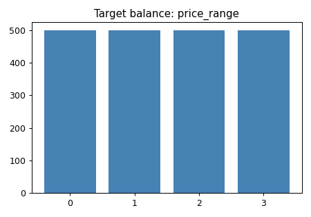
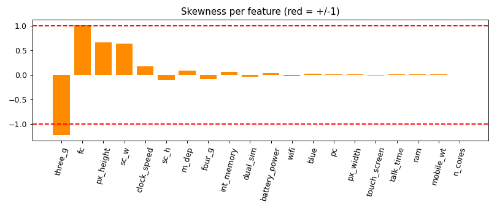
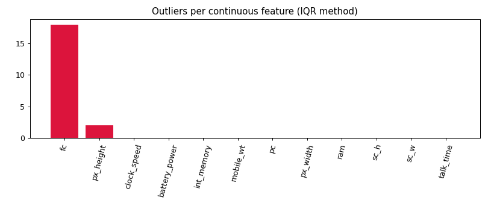
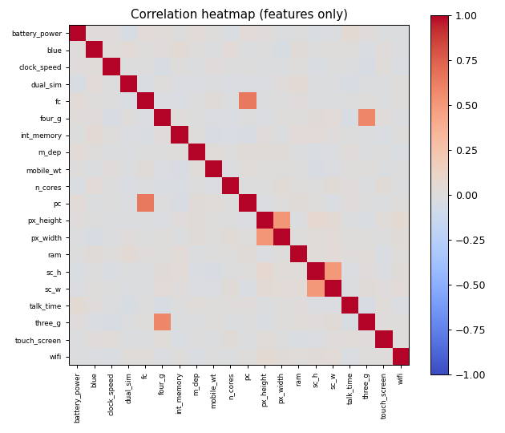
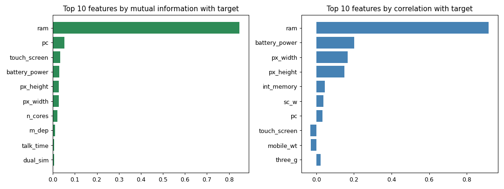

# Mobile Price Analysis - EDA Summary

## Key findings
1. The dataset has 2,000 rows and 21 columns (12 continuous, 6 binary, 2 discrete) using 0.32 MB.
2. Missing values: 0. Duplicate rows: 0.
3. The target 'price_range' has 4 classes with counts 0: 500, 1: 500, 2: 500, 3: 500.
4. 2 feature(s) are strongly skewed: three_g, fc.
5. Feature scales differ a lot (range from 2.5 to 3742).
6. Outliers (IQR) exist in 2 feature(s); the most affected is fc (18 values).
7. No pair of features has |r| >= 0.8; multicollinearity is not a concern.
8. Features most related to 'price_range': ram, pc, touch_screen (strongest: ram, mutual information 0.85, correlation 0.92).
9. 12 feature(s) carry almost no information about the target: talk_time, dual_sim, fc, clock_speed, blue, sc_w, four_g, int_memory, mobile_wt, sc_h, three_g, wifi.

## Recommendations / next steps
1. No missing values, so no imputation is needed.
2. Classes are balanced, so plain accuracy is a fair metric.
3. Apply a log or square-root transform to: three_g, fc.
4. Scale the features (StandardScaler) before distance-based models such as KNN, SVM or PCA.
5. Check the outliers: keep valid extreme values, cap or remove the rest (Task 9).
6. Consider dropping or testing the removal of low-value features: talk_time, dual_sim, fc, clock_speed, blue, sc_w, four_g, int_memory, mobile_wt, sc_h, three_g, wifi.
7. Build a first baseline model (e.g. Random Forest) and compare with a version that uses only the top features (ram, pc, touch_screen, ...).
8. Detect multivariate anomalies with Isolation Forest (Task 12) before final modelling.

## Key visualizations






## Statistics

```
                  mean      std    min     50%     max  skew
battery_power  1238.52   439.42  501.0  1226.0  1998.0  0.03
blue              0.50     0.50    0.0     0.0     1.0  0.02
clock_speed       1.52     0.82    0.5     1.5     3.0  0.18
dual_sim          0.51     0.50    0.0     1.0     1.0 -0.04
fc                4.31     4.34    0.0     3.0    19.0  1.02
four_g            0.52     0.50    0.0     1.0     1.0 -0.09
int_memory       32.05    18.15    2.0    32.0    64.0  0.06
m_dep             0.50     0.29    0.1     0.5     1.0  0.09
mobile_wt       140.25    35.40   80.0   141.0   200.0  0.01
n_cores           4.52     2.29    1.0     4.0     8.0  0.00
pc                9.92     6.06    0.0    10.0    20.0  0.02
px_height       645.11   443.78    0.0   564.0  1960.0  0.67
px_width       1251.52   432.20  500.0  1247.0  1998.0  0.01
ram            2124.21  1084.73  256.0  2146.5  3998.0  0.01
sc_h             12.31     4.21    5.0    12.0    19.0 -0.10
sc_w              5.77     4.36    0.0     5.0    18.0  0.63
talk_time        11.01     5.46    2.0    11.0    20.0  0.01
three_g           0.76     0.43    0.0     1.0     1.0 -1.23
touch_screen      0.50     0.50    0.0     1.0     1.0 -0.01
wifi              0.51     0.50    0.0     1.0     1.0 -0.03
price_range       1.50     1.12    0.0     1.5     3.0  0.00
```